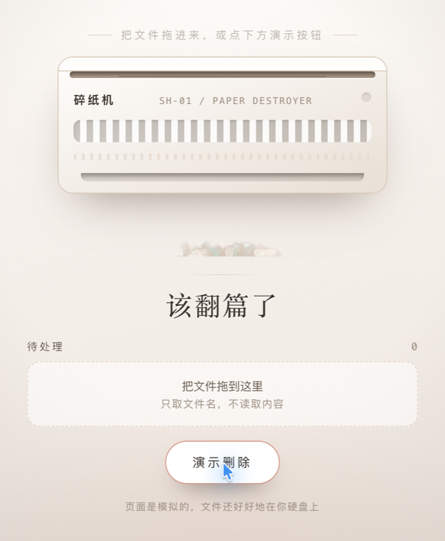

# shredder-theater 🗑️

> 把「删除文件」变成一场好看的演出。

一个给 AI 编码助手用的 **skill**：丢给它一句「做个碎纸机页面」，它就产出一个单文件 HTML——
拖文件进去，纸被吸进碎纸机，机身抖动，Web Audio 现场合成的碎纸声响起，纸屑簌簌落下，
最后一句话轻轻落下来：「主人，已处理完毕」。



---

## 它做什么

| 能力 | 说明 |
|---|---|
| 🎨 纯视觉 | CSS 手绘碎纸机（面板 / 进纸口 / 指示灯 / 滚轮），不用任何图片素材 |
| 🔊 现场合成音效 | 白噪声 + 锯齿波实时合成碎纸声与收尾提示音，**仓库里没有一个音频文件** |
| ✍️ 情绪文案 | 收尾那句话从内置文案库里按场景选，不写「删除成功」这种系统提示语 |
| 📱 手机能看 | 响应式单页，`clamp()` 控字号，`dvh` 处理移动端视口 |
| 📦 单文件 | CSS / JS 全内联，断网可开，双击就跑 |

---

## 安装

把 skill 目录放进你的 skills 根目录即可：

```bash
git clone https://github.com/Madeline-design/shredder-theater.git
cp -r shredder-theater/skills/shredder-theater ~/.minimax/skills/
# Claude Code 用这个路径：
# cp -r shredder-theater/skills/shredder-theater ~/.claude/skills/
```

Mavis 会自动发现并加载它。

## 使用

直接说人话就行：

- 「做个碎纸机页面，删完显示『主人，已处理完毕』」
- 「想做一个狠一点的，前任发来的文件全碎掉」
- 「给妈做个仪式感的告别页面」

skill 会自己定配色、选文案、生成 HTML、自检，然后交给你一个文件。

---

## 目录结构

```
shredder-theater/
├── README.md
├── LICENSE
└── skills/
    └── shredder-theater/
        ├── SKILL.md                    # 执行规约：流程 / 产出契约 / 失败处理
        └── references/
            ├── visual-language.md      # 五套配色、字体、动效参数、质感技巧、避坑
            └── message-templates.md    # 按场景分类的收尾文案库
```

## 设计约束

这个 skill 里有几条硬规矩，来自真实的失败经验：

- **不真删文件。** 它只做演出，不碰磁盘。需要真删的时候它会直说。
- **不打包音频。** 声音用 Web Audio 合成，仓库保持纯文本，clone 下来很轻。
- **不用 emoji 当主视觉。** 也不用渐变文字 + 发光按钮那种通用 SaaS 味。
- **交付前必须自检。** 声音、动画、文案时序、手机视口、console 报错，逐条过。

## License

MIT
